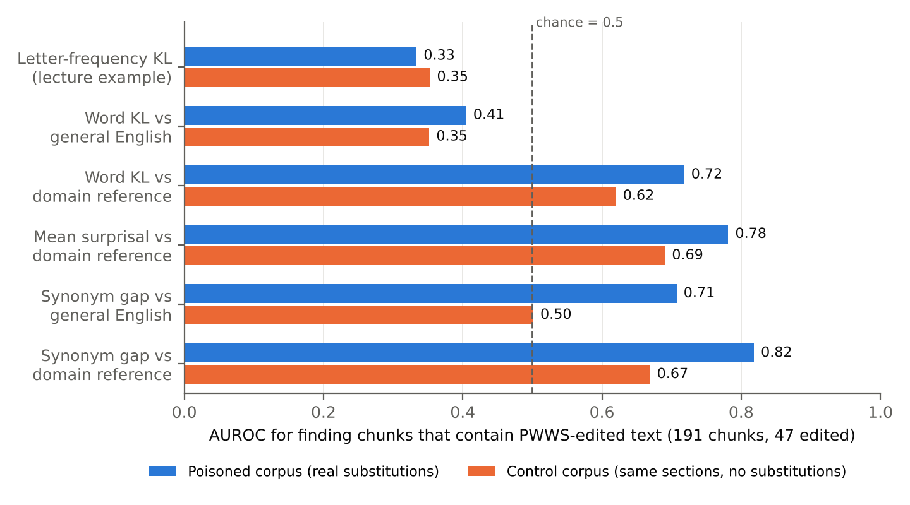
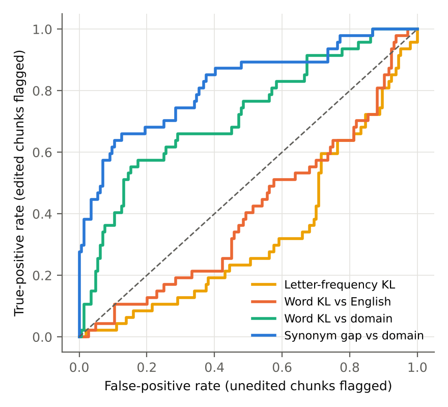
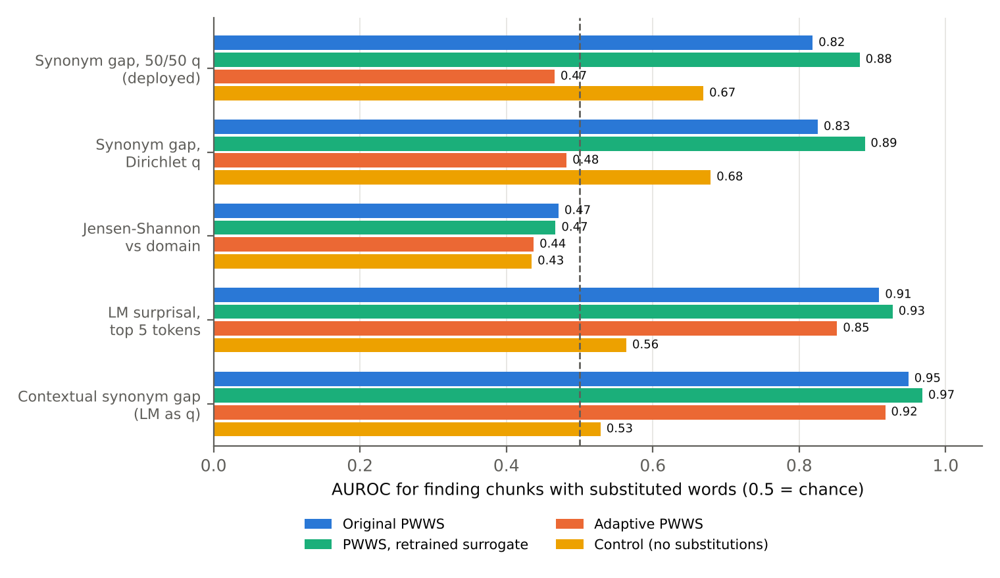
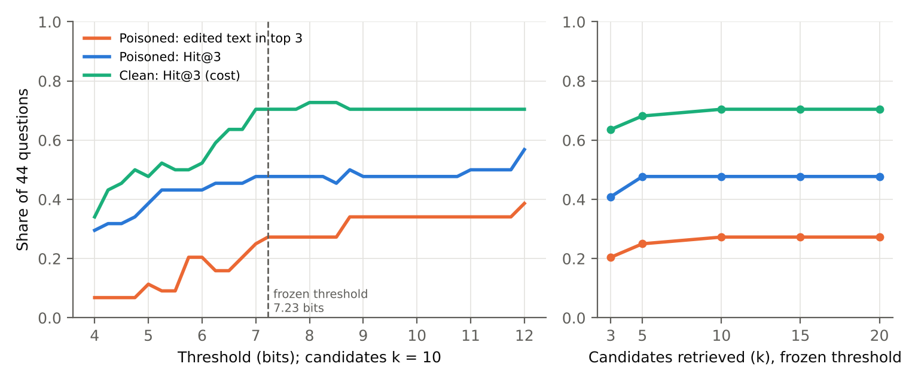
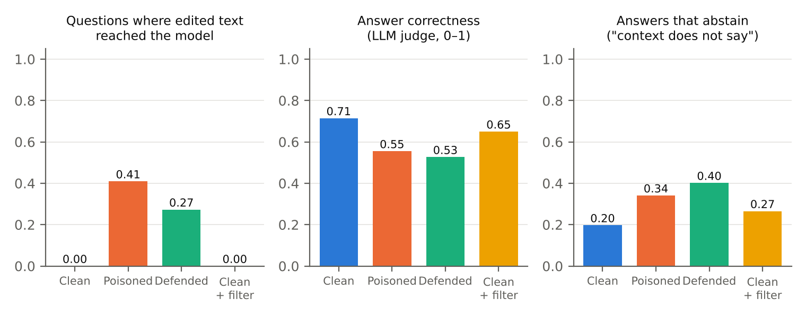
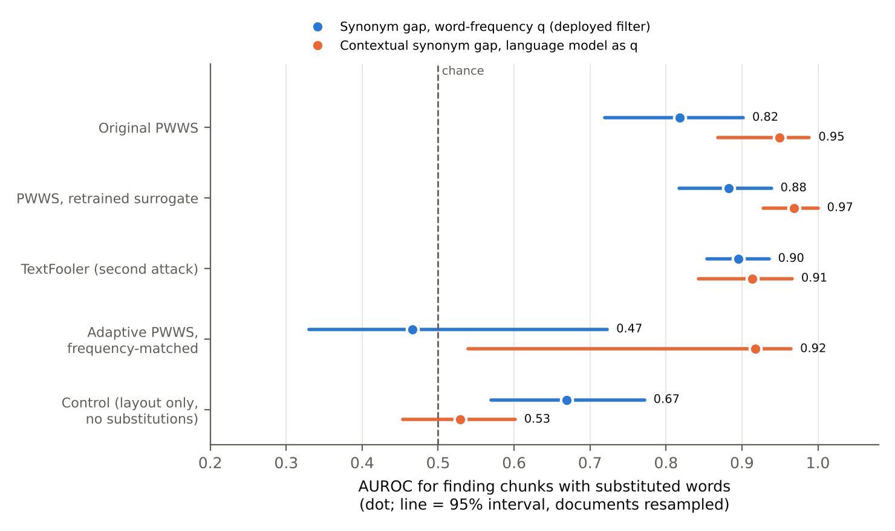
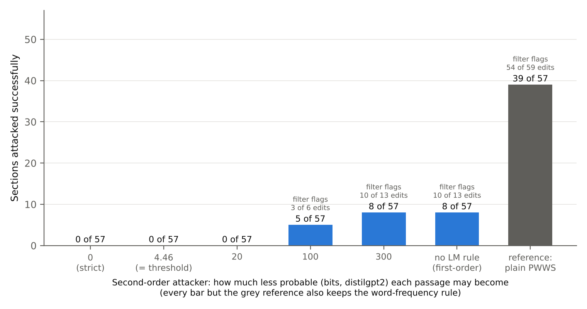
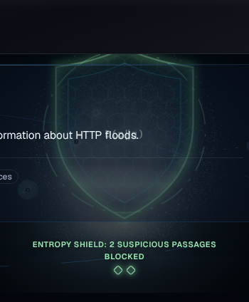

# 1. What this pack contains

| Document | What it is |
|---|---|
| `01-briefing.pdf` | The whole project explained: motivation, design, code, metrics, results, limitations, next steps, likely questions |
| `02-evidence-pack.pdf` | This document: figures, run register, every headline number traced to its file |
| `03-results-write-up.pdf` | Full methods and results (20 sections), the reference for the dissertation's Method and Results chapters |
| `04-project-definition-document.pdf` | PDD, rebuilt to Project Handbook §4.5 |
| `05-paper-draft.pdf` | Research paper draft (to be extended for IEEE TDSC) |
| `06-note-for-dr-komninos.pdf` | The two-page note sent on 18 October |
| `07-demo-video-plan.md` | Plan for the 15-minute demo video |
| `results/` | The summary files every number below is read from |
| `figures/` | All figures as PNG |

The code, data, corpora and all raw run records are in the Git repository (branch `feature/aegisrag-evidence-check`).

# 2. How the evidence is kept honest

- **Create-only records.** Each run writes one JSON file per model call (prompt, retrieved passages, answer, judge output, timings, errors). Files are never overwritten.
- **Checksums.** At the end of a run, a completion file stores the SHA-256 of every record. Any later change is detectable.
- **Snapshotted inputs.** Each run's manifest stores the benchmark, both corpora, the attack manifest, the configuration and the hash of every code file used.
- **Failures are kept.** A failed call is recorded and counted as missing, never as zero; the failed pilot is kept and reported.
- **Thresholds frozen first.** Detector thresholds were fixed on development documents before any answer-level evaluation and never re-tuned.
- **Automatic claim check.** `docs/research/scripts/verify_evidence.py` re-reads every headline number from its result file and re-hashes every run record (Section 5).
- **Negative results reported.** Letter-level KL, Jensen–Shannon, the repair defence and the evidence check did not work, and are reported as such.

# 3. Run register

| Run | Purpose | Records | Completed and checksummed |
|---|---|---|---|
| `20260913T164257Z…` | Pilot 1 (12 q × 3): excluded, vector database unreachable, 0 model calls | 324 | yes |
| `20260914T101059Z…` | Pilot 2 (12 q × 3): clean vs poisoned | 324 | yes |
| `20261016T222418Z…` | Main run (44 q × 3): clean vs PWWS-poisoned | 1188 | yes |
| `20261017T165331Z…` | Word-frequency filter live (defended, clean_filtered) | 792 | yes |
| `20261018T101453Z…` | Repair defence live (repaired, clean_repaired) | 792 | yes |
| `20261018T180113Z…` | Language-model filter live (contextual, clean_contextual) | 792 | yes |
| `20261019T200355Z…` | Evidence check replayed on 352 answers | 352 | yes |
| `20261019T200851Z…` | Both filters live on the TextFooler corpus | 1188 | yes |

About 5,750 records in total. Every record's checksum still matches (Section 5).

# 4. Figures

# 5. Every headline number, traced to its file

**83 of 83 claims match; every run record is unchanged since its run finished.** To re-check: `python docs/research/scripts/verify_evidence.py` from the repository root (no model calls, about a minute).

| Claim | Quoted | In file | Check | Source |
|---|---|---|---|---|
| Main run: clean correctness | 0.714 | 0.714 | ok | `docs/research/results/main-v1-20261016/summary.json` |
| Main run: poisoned correctness | 0.5549 | 0.5549 | ok | `docs/research/results/main-v1-20261016/summary.json` |
| Main run: correctness drop | -0.1591 | -0.1591 | ok | `docs/research/results/main-v1-20261016/summary.json` |
| Main run: drop on perturbed targets | -0.25 | -0.25 | ok | `docs/research/results/main-v1-20261016/summary.json` |
| Main run: drop on unperturbed targets | -0.0147 | -0.0147 | ok | `docs/research/results/main-v1-20261016/summary.json` |
| Main run: ASR (section exposure) | 0.2803 | 0.2803 | ok | `docs/research/results/main-v1-20261016/summary.json` |
| Main run: ASR (edited-text exposure) | 0.1667 | 0.1667 | ok | `docs/research/results/main-v1-20261016/summary.json` |
| Main run: poisoned abstentions | 45 | 45 | ok | `docs/research/results/main-v1-20261016/summary.json` |
| Main run: poisoned confident errors | 2 | 2 | ok | `docs/research/results/main-v1-20261016/summary.json` |
| Detector: synonym gap vs domain, AUROC all | 0.82 | 0.8184 | ok | `docs/research/results/entropy-detector-20261016/detector-poisoned.json` |
| Detector: synonym gap vs domain, AUROC held-out | 0.94 | 0.9371 | ok | `docs/research/results/entropy-detector-20261016/detector-poisoned.json` |
| Detector: letter-frequency KL, AUROC all | 0.33 | 0.3338 | ok | `docs/research/results/entropy-detector-20261016/detector-poisoned.json` |
| Detector: word KL vs domain, AUROC all | 0.72 | 0.7182 | ok | `docs/research/results/entropy-detector-20261016/detector-poisoned.json` |
| Detector: synonym gap on control corpus, AUROC | 0.67 | 0.6691 | ok | `docs/research/results/entropy-detector-20261016/detector-control.json` |
| Detector: frozen threshold (bits) | 7.2262 | 7.2262 | ok | `docs/research/results/entropy-detector-20261016/detector-poisoned.json` |
| Matched control: syngap higher in edited chunk | 38 | 38 | ok | `docs/research/results/entropy-defence/matched-control.json` |
| Explanations: flagged edited chunks | 27 | 27 | ok | `docs/research/results/entropy-defence/explanations.json` |
| Explanations: cite a real substitution | 25 | 25 | ok | `docs/research/results/entropy-defence/explanations.json` |
| Explanations: name the exact original | 22 | 22 | ok | `docs/research/results/entropy-defence/explanations.json` |
| Defence: exposure, poisoned | 0.4091 | 0.4091 | ok | `docs/research/results/entropy-defence/live-paired/summary.json` |
| Defence: exposure, defended | 0.2727 | 0.2727 | ok | `docs/research/results/entropy-defence/live-paired/summary.json` |
| Defence: exposure change, Wilcoxon p | 0.0312 | 0.0312 | ok | `docs/research/results/entropy-defence/live-paired/summary.json` |
| Defence: correctness change vs poisoned | -0.0284 | -0.0284 | ok | `docs/research/results/entropy-defence/live-paired/summary.json` |
| Defence: correctness change on perturbed targets | -0.071 | -0.071 | ok | `docs/research/results/entropy-defence/live-paired/summary.json` |
| Defence: cost on clean correctness | -0.0644 | -0.0644 | ok | `docs/research/results/entropy-defence/live-paired/summary.json` |
| Defence: confident errors, defended | 0 | 0 | ok | `docs/research/results/entropy-defence/live-paired/summary.json` |
| Defence: abstentions, defended | 53 | 53 | ok | `docs/research/results/entropy-defence/live-paired/summary.json` |
| Defence: ASR (edited exposure), defended | 0.1061 | 0.1061 | ok | `docs/research/results/entropy-defence/live-paired/summary.json` |
| Sweep: deployed setting reproduces live exposure | 0.2727 | 0.2727 | ok | `docs/research/results/entropy-defence/threshold-sweep/sweep.json` |
| Sweep: unfiltered poisoned exposure | 0.4091 | 0.4091 | ok | `docs/research/results/entropy-defence/threshold-sweep/sweep.json` |
| Repair: correctness, repaired | 0.506 | 0.5057 | ok | `docs/research/results/entropy-repair/live-paired/summary.json` |
| Repair: correctness change vs drop defence | -0.021 | -0.0208 | ok | `docs/research/results/entropy-repair/live-paired/summary.json` |
| Repair: edited text reaching the model | 0.364 | 0.3636 | ok | `docs/research/results/entropy-repair/live-paired/summary.json` |
| Repair: confident errors | 0 | 0 | ok | `docs/research/results/entropy-repair/live-paired/summary.json` |
| Repair: ASR (edited exposure) | 0.1818 | 0.1818 | ok | `docs/research/results/entropy-repair/live-paired/summary.json` |
| Contextual synonym gap, poisoned corpus, AUROC | 0.95 | 0.9492 | ok | `docs/research/results/entropy-family/family-poisoned.json` |
| Contextual synonym gap, held-out, AUROC | 0.88 | 0.8829 | ok | `docs/research/results/entropy-family/family-poisoned.json` |
| Contextual synonym gap, formatting-only control, AUROC | 0.53 | 0.5287 | ok | `docs/research/results/entropy-family/family-control.json` |
| Contextual synonym gap, adaptive attack, AUROC | 0.92 | 0.9175 | ok | `docs/research/results/entropy-family/family-poisoned_adaptive.json` |
| Deployed synonym gap, adaptive attack, AUROC | 0.47 | 0.4659 | ok | `docs/research/results/entropy-family/detector-poisoned_adaptive.json` |
| Jensen-Shannon, poisoned corpus, AUROC | 0.47 | 0.4713 | ok | `docs/research/results/entropy-family/family-poisoned.json` |
| Dirichlet synonym gap, poisoned corpus, AUROC | 0.83 | 0.8254 | ok | `docs/research/results/entropy-family/family-poisoned.json` |
| Matched control: deployed synonym gap AUROC | 0.88 | 0.8826 | ok | `docs/research/results/entropy-family/detector-poisoned_pwws_rerun.json` |
| Matched control: contextual synonym gap AUROC | 0.97 | 0.9683 | ok | `docs/research/results/entropy-family/family-poisoned_pwws_rerun.json` |
| Adaptive attack: successful sections | 8 | 8 | ok | `docs/research/results/adaptive-attack/surrogate-and-attack-record.json` |
| Sweep: deployed setting keeps clean Hit@3 | 0.7045 | 0.7045 | ok | `docs/research/results/entropy-defence/threshold-sweep/sweep.json` |
| Contextual defence: exposure, contextual | 0.204 | 0.2045 | ok | `docs/research/results/contextual-defence/live-paired/summary.json` |
| Contextual defence: exposure change, Wilcoxon p | 0.012 | 0.0117 | ok | `docs/research/results/contextual-defence/live-paired/summary.json` |
| Contextual defence: correctness, contextual | 0.485 | 0.4848 | ok | `docs/research/results/contextual-defence/live-paired/summary.json` |
| Contextual defence: correctness change, Wilcoxon p | 0.02 | 0.02 | ok | `docs/research/results/contextual-defence/live-paired/summary.json` |
| Contextual defence: cost on clean correctness | -0.013 | -0.0133 | ok | `docs/research/results/contextual-defence/live-paired/summary.json` |
| Contextual defence: confident errors | 0 | 0 | ok | `docs/research/results/contextual-defence/live-paired/summary.json` |
| Contextual defence: abstentions | 63 | 63 | ok | `docs/research/results/contextual-defence/live-paired/summary.json` |
| Contextual defence: ASR (edited exposure) | 0.1136 | 0.1136 | ok | `docs/research/results/contextual-defence/live-paired/summary.json` |
| TextFooler: successful sections | 49 | 49 | ok | `backend/data/poisoned_textfooler/pwws_attack_manifest.jsonl` |
| TextFooler: deployed synonym gap AUROC | 0.9 | 0.8954 | ok | `docs/research/results/entropy-family/detector-poisoned_textfooler.json` |
| TextFooler: contextual synonym gap AUROC | 0.91 | 0.9139 | ok | `docs/research/results/entropy-family/family-poisoned_textfooler.json` |
| Second-order (strict): successful sections | 0 | 0 | ok | `backend/data/poisoned_adaptive_lm/pwws_attack_manifest.jsonl` |
| Second-order (4.46-bit budget): successful sections | 0 | 0 | ok | `backend/data/poisoned_adaptive_lm_budget/pwws_attack_manifest.jsonl` |
| Diagnostic: swaps used by unrestricted PWWS | 550 | 550 | ok | `docs/research/results/adaptive-attack/second-order-diagnostic.json` |
| Diagnostic: swaps passing the LM rule | 9 | 9 | ok | `docs/research/results/adaptive-attack/second-order-diagnostic.json` |
| Diagnostic: swaps passing both rules | 5 | 5 | ok | `docs/research/results/adaptive-attack/second-order-diagnostic.json` |
| Diagnostic: median LM cost of a swap (bits) | -17.861 | -17.861 | ok | `docs/research/results/adaptive-attack/second-order-diagnostic.json` |
| Second-order (20-bit budget): successful sections | 0 | 0 | ok | `backend/data/poisoned_adaptive_lm_budget_20/pwws_attack_manifest.jsonl` |
| Second-order (100-bit budget): successful sections | 5 | 5 | ok | `backend/data/poisoned_adaptive_lm_budget_100/pwws_attack_manifest.jsonl` |
| Second-order (300-bit budget): successful sections | 8 | 8 | ok | `backend/data/poisoned_adaptive_lm_budget_300/pwws_attack_manifest.jsonl` |
| Second-order (100-bit): contextual gap AUROC | 0.78 | 0.7802 | ok | `docs/research/results/entropy-family/family-poisoned_adaptive_lm_budget_100.json` |
| Second-order (300-bit): contextual gap AUROC | 0.92 | 0.9175 | ok | `docs/research/results/entropy-family/family-poisoned_adaptive_lm_budget_300.json` |
| Intervals: contextual minus word-frequency AUROC, PWWS | 0.131 | 0.1308 | ok | `docs/research/results/detector-uncertainty/auroc-intervals.json` |
| Intervals: contextual AUROC on PWWS, lower bound | 0.87 | 0.8683 | ok | `docs/research/results/detector-uncertainty/auroc-intervals.json` |
| Frozen contextual threshold: TextFooler edits flagged | 70 | 70 | ok | `docs/research/results/detector-uncertainty/auroc-intervals.json` |
| Frozen contextual threshold: first-order adaptive edits flagged | 10 | 10 | ok | `docs/research/results/detector-uncertainty/auroc-intervals.json` |
| TextFooler live: exposure without defence | 0.818 | 0.8182 | ok | `docs/research/results/textfooler-defence/summary.json` |
| TextFooler live: exposure with contextual filter | 0.523 | 0.5227 | ok | `docs/research/results/textfooler-defence/summary.json` |
| TextFooler live: contextual exposure change, Wilcoxon p | 0.0002 | 0.0002 | ok | `docs/research/results/textfooler-defence/summary.json` |
| TextFooler live: exposure with word-frequency filter | 0.795 | 0.7955 | ok | `docs/research/results/textfooler-defence/summary.json` |
| TextFooler live: correctness drop vs clean | -0.15 | -0.1496 | ok | `docs/research/results/textfooler-defence/summary.json` |
| TextFooler live: refusals with contextual filter | 74 | 74 | ok | `docs/research/results/textfooler-defence/summary.json` |
| Evidence check: precision (error = not correct) | 0.28 | 0.28125 | ok | `docs/research/results/evidence-check/summary.json` |
| Evidence check: recall | 0.2 | 0.2 | ok | `docs/research/results/evidence-check/summary.json` |
| Evidence check: false-alarm rate | 0.31 | 0.3108108108108108 | ok | `docs/research/results/evidence-check/summary.json` |
| Evidence check: partial answers fully supported | 68 | 68 | ok | `docs/research/results/evidence-check/summary.json` |
| Frozen contextual threshold: PWWS edits flagged | 42 | 42 | ok | `docs/research/results/detector-uncertainty/auroc-intervals.json` |

# 6. How to reproduce

Every analysis can be re-run offline from the saved records; the exact commands are in `03-results-write-up.pdf`, section 9. Live runs need the OpenAI API key and Qdrant, and are resumable.
